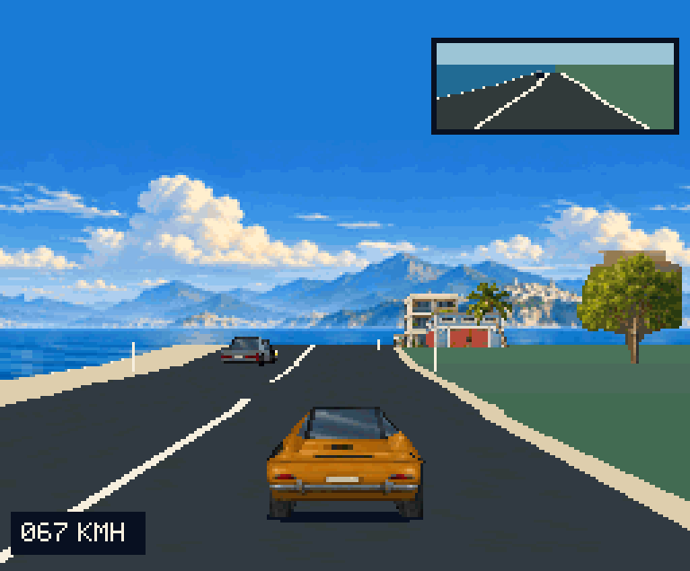
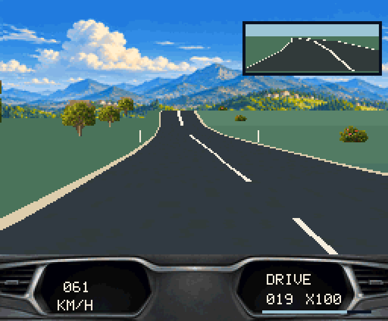

# MAGICAL HAPPY RALLY 3D

**操作できる開発途中の走行デモ / Playable work-in-progress driving demo**

[ダウンロード / Downloads](https://github.com/kanon-ai/MAGICAL-HAPPY-RALLY-3D/releases/tag/v0.1.0-demo) · [English](#english) · [実行方法 / Running](docs/RUNNING.md) · [ビルド / Building](docs/BUILDING.md)





[約2分の走行動画 / Two-minute driving video](https://github.com/kanon-ai/MAGICAL-HAPPY-RALLY-3D/releases/download/v0.1.0-demo/MAGICAL_HAPPY_RALLY_3D_preview.mp4)

## 日本語

MSX turbo R + V9968 + Geo3D V2向けの公道ドライブ試作です。映像を眺めるだけの自動デモではなく、**自分で加速・ブレーキ・操舵し、運転席／背面視点を切り替えて走行できます。**

**ゲーム性・難易度・衝突判定・交通の挙動などは、まだ全く調整が済んでいません。完成したレースゲームではありません。** 現時点は描画、速度感、景色のつながり、音楽を試すための走行デモです。順位やレース競技はありません。

海岸から内陸、街の入口へ景色が移り変わる連続コース、一般車5台、バックミラー、カーブと起伏、OPLL BGMを搭載しています。街並みは次ステージへの準備であり、完成済みの街ステージが別に収録されているわけではありません。

### 入手と実行

1. ReleasesからデモZIPをダウンロードして展開します。
2. **Geo3D V2・V9968対応版openMSX**と、適法に入手した必要なMSX turbo RのBIOSを別途用意します。通常版openMSXでは実行できません。
3. Windowsでは、対応版の実行ファイルを指定して起動します。

```powershell
python tools/play.py --openmsx "C:/path/to/compatible-openmsx/openmsx.exe"
```

必要な機種定義、詳しい設定、直接起動するコマンドは[実行方法](docs/RUNNING.md)を参照してください。BIOS・エミュレーター・FPGAデータは同梱していません。

| 操作 | キー |
|---|---|
| 開始・加速 | Space / ↑ |
| 操舵 | ← / → |
| ブレーキ | X / ↓ |
| 運転席／背面視点 | C |
| ポーズ・復帰 | Esc |
| ポーズ中にメニューへ | X |
| 完走後の再走行 | Space |

### 対応・現在の制限

- 4MiB ASCII16 ROM、R800、RAM 256KiB以上、V9968（内蔵98h I/O）・Geo3D V2、OPLL/MSX-MUSICが必要です。通常のMSX/MSX2やGeo3D V1向けではありません。外付け88h版ではありません。
- 作者の対応版openMSXで検証しました。**この公開ROMの実機・FPGA・BlueMSX+動作は未検証**です。すべての対応環境での動作を保証しません。
- 同一比較走行で約16.04fps、背面／運転席を含む完走テスト平均約20.53fps。エミュレーター上の計測値であり、実機性能や常時30fpsを意味しません。
- 車両の接触、追い越し、モデル・テクスチャ、景観には不自然な表現が残ります。後方からの衝突判定はありません。
- コースは約16.384km。既存道路形状を再利用しており、繰り返しがあります。走行速度で所要時間は変わります。
- 極端に重いフレームでは既存の時計表示が時間を取りこぼす可能性があります。記録・競技用途には使えません。
- ROMは検証済みスナップショットをそのまま公開しています。ゲーム内の旧仮称「PUBLIC ROAD / COCKPIT」は残っています。

### 音楽・権利・免責

BGMは **Costal Drive - OPLL arrangement（音量調整版）**。作者の申告に基づき、Sunoの有料プレミアムアカウントを使用して制作した楽曲を、MSX音楽エディタで編曲しOPLL用データにしています。画像素材にはAI生成画像と、その加工データを使用しています。

コードは[MIT License](LICENSE)。素材・音楽・ROM全体の扱いは[別条件](ASSET_LICENSE.md)、制作元と依存関係は[クレジット](THIRD_PARTY_NOTICES.md)をご覧ください。**素材・音楽までMITで自由利用できるという意味ではありません。**

本作は現状有姿・無保証の試作品です。動作、互換性、性能、正確性、継続開発や修正を保証しません。利用に伴う損害については、適用法で認められる範囲で責任を負いません。法令上免責できない責任を排除するものではありません。使用環境やデータの管理は利用者自身で行ってください。

## English

MAGICAL HAPPY RALLY 3D is a public-road driving prototype for **MSX turbo R + V9968 + Geo3D V2**. It is **actually playable**: accelerate, brake, steer, and switch between cockpit and chase views yourself.

**Gameplay, difficulty, collisions and traffic behavior have not been tuned. This is not a finished racing game.** The current release demonstrates rendering, movement, scenery transitions and music. There is no competitive ranking or developed race mode.

A continuous route moves from the coast into inland scenery and the outskirts of a town. It includes five traffic cars, a rear-view mirror, bends, elevation changes and OPLL music. The town scenery prepares for a future stage; it is not a separate completed city stage.

### Download and play

Download and extract the demo ZIP from Releases. Obtain a **Geo3D V2/V9968-capable openMSX build** and legally obtained MSX turbo R system ROMs separately. Standard openMSX does not support this demo. Start it with:

```powershell
python tools/play.py --openmsx "C:/path/to/compatible-openmsx/openmsx.exe"
```

See [Running](docs/RUNNING.md) for machine definitions, direct commands and troubleshooting. BIOS files, emulator binaries and FPGA firmware are not included.

| Action | Key |
|---|---|
| Start / accelerate | Space / Up |
| Steer | Left / Right |
| Brake | X / Down |
| Cockpit / chase view | C |
| Pause / resume | Esc |
| Return to menu while paused | X |
| Drive again after finishing | Space |

### Requirements and limitations

- 4MiB ASCII16 ROM; R800; at least 256KiB RAM; V9968 on the **internal 98h I/O ports**; Geo3D V2; OPLL/MSX-MUSIC. Not for stock MSX/MSX2, Geo3D V1 or the external 88h configuration.
- Tested in the author's compatible openMSX build. **This release has not been verified on physical hardware, FPGA hardware or BlueMSX+.** Compatibility is not guaranteed.
- Approximately 16.04fps in the comparison replay and 20.53fps averaged across a full mixed-view drive. These are emulator measurements, not hardware guarantees or a constant 30fps claim.
- Collisions, overtaking, models, textures and scenery still contain rough edges. Rear-end collision detection from behind is not implemented.
- Approximately 16.384km, with reused road geometry and visible repetition. Duration depends on driving speed.
- The existing clock may lose elapsed time during exceptionally slow frames. Timing is not suitable for competition.
- The tested ROM is published unchanged. Its old working title, `PUBLIC ROAD / COCKPIT`, remains on the menu.

### Music, license and disclaimer

Music: **Costal Drive - OPLL arrangement (volume-adjusted version)**. According to the author, the music was created using a paid Suno premium account and arranged for OPLL with an MSX music editor. Visual assets include AI-generated images and edited derivatives.

Project-authored code is under the [MIT License](LICENSE). [Separate terms](ASSET_LICENSE.md) apply to artwork, music, game data and the combined ROM. See [credits and third-party notices](THIRD_PARTY_NOTICES.md). **The music and artwork are not offered under MIT.**

This experimental software is provided **AS IS, WITHOUT WARRANTY**. Operation, compatibility, performance, accuracy, continued development and fixes are not guaranteed. To the extent permitted by applicable law, the authors are not liable for damages arising from its use. Nothing excludes liability that cannot legally be excluded. Users are responsible for their own setup and data.
